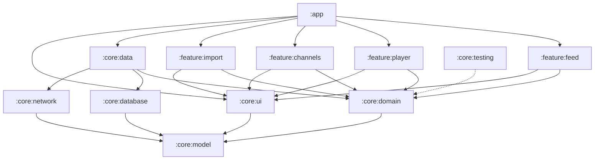

# Архитектура

Clean Architecture + MVVM с однонаправленным потоком данных (UDF). Room — единственный источник
истины: интерфейс читает только из базы, сеть только обновляет базу.

## Модули



| Модуль | Тип | Ответственность |
|---|---|---|
| `:app` | Android app | `Application` (Hilt, WorkManager), `MainActivity`, `UsefulYouTubeNavHost` |
| `:core:model` | JVM | Доменные модели, `AppResult`, иерархия ошибок `AppError` |
| `:core:domain` | JVM | Use cases, интерфейсы репозиториев, `ShortsDetector`, разбор ввода канала |
| `:core:data` | Android library | Реализации репозиториев, мапперы, CSV-парсер, воркер, Hilt-привязки |
| `:core:database` | Android library | Room: entities, DAO, схема (`schemas/`) |
| `:core:network` | Android library | Retrofit (Data API), RSS-парсер (xmlutil), DTO, маппинг сетевых ошибок |
| `:core:ui` | Android library | Тема, общие компоненты (`LoadingContent`, `MessageContent`), тексты ошибок |
| `:core:testing` | JVM | Фейковые репозитории, `TestData`, `MainDispatcherRule`, `collectInBackground` |
| `:feature:*` | Android library | Экраны: `XViewModel`, `XUiState`, `XUiEvent`, `XScreen`, `XRoute`, навигация |

Правила зависимостей:

- Зависимости направлены внутрь: feature → domain ← data. Feature-модули не зависят друг от друга.
  Связи между экранами задаёт `:app` через колбэки навигации.
- `:core:model` и `:core:domain` — JVM-модули, поэтому Android-зависимость в них не подключится.
  В домене есть только `javax.inject` и Dagger (через `hilt-core`).
- Feature-модули не знают о `:core:data`, `:core:database` и `:core:network`.

Пакет модуля `:feature:import` называется `feature.subscriptionimport`, потому что `import` —
ключевое слово Kotlin.

## Слои и поток данных

```
UI (Compose)  ──onEvent(UiEvent)──▶  ViewModel  ──▶  UseCase  ──▶  Repository (interface, domain)
     ▲                                  │                               │
     └──────── StateFlow<UiState> ◀─────┘                               ▼
                                                    OfflineFirst*Repository (data)
                                                      │                 │
                                               Room (Flow)       YouTubeNetworkDataSource
```

- Каждая ViewModel выставляет один `StateFlow<UiState>` и принимает события через `onEvent(UiEvent)`.
- Экраны stateless: `XScreen(state, onEvent, …колбэки навигации)`. `XRoute` связывает экран с
  ViewModel через `hiltViewModel()` и `collectAsStateWithLifecycle()`.
- Состояние строится комбинацией потоков из Room и локального состояния ViewModel
  (`combine(...).stateIn(WhileSubscribed(5 s))`).

## Обновление ленты

`RefreshFeedUseCase` (домен) управляет всем процессом:

1. Берёт все каналы и параллельно (не больше 8 запросов одновременно, `Semaphore`) загружает их
   RSS: `https://www.youtube.com/feeds/videos.xml?channel_id={id}`.
2. Новые видео сохраняются в `videos` с `content_kind = UNCLASSIFIED` и `details_fetched = 0`.
   Существующие строки не перезаписываются.
3. Для видео без деталей запрашивается `videos.list?part=contentDetails,snippet` батчами по 50 id.
   Длительность (ISO 8601) и полное описание пишутся в базу.
4. Видео с деталями, но без вида, проходят через `ShortsDetector` (тоже не больше 8 одновременно),
   а результат сохраняется в `content_kind`.

Обработка ошибок:

- Ошибка одного канала не останавливает обновление. Канал попадает в `RefreshSummary.failedChannels`,
  в интерфейсе это не показывается.
- Если не обновился ни один канал или не удалось загрузить детали, возвращается
  `AppResult.Failure(DataError)`.

Лента показывает только `REGULAR` и `LIVE_OR_PREMIERE`. `SHORT` и `UNCLASSIFIED` скрыты.
Видео, которые Data API не вернул (удалены или приватны), остаются скрытыми, а их детали
запрашиваются заново при следующем обновлении.

Обновление запускается:

- при открытии ленты (`FeedViewModel.init`);
- по pull-to-refresh;
- в фоне раз в час, только при наличии сети (`FeedSyncScheduler` → `RefreshFeedWorker`).

`RefreshFeedWorker` повторяет попытку (`retry`) при временных ошибках: нет сети, HTTP, неизвестная
ошибка. При неверном ключе, исчерпанной квоте, `NotFound` и ошибке разбора он сдаётся (`failure`).

## Определение Shorts

Стратегия `ShortsDetector` (`:core:domain/shorts`):

| Класс | Правило |
|---|---|
| `DurationShortsDetector` | `null` → `UNKNOWN`; `0` (P0D, трансляция или премьера) → `NOT_SHORT`; ≤ 180 с → `SHORT`; иначе `NOT_SHORT` |
| `UrlShortsDetector` | HEAD `https://www.youtube.com/shorts/{id}` без следования редиректам: `200` → `SHORT`; редирект на `/watch` → `NOT_SHORT`; любой другой ответ или ошибка → `UNKNOWN` |
| `CompositeShortsDetector(screening, confirmation)` | Сначала дешёвая проверка; только её вердикт `SHORT` проверяется дорогой. При `UNKNOWN` от проверки остаётся первый вердикт |

В приложении используется `Composite(Duration, Url)` (см. `DataModule`). Видео длиннее 3 минут
классифицируются без сетевых запросов. Короткие обычные ролики не теряются, а если YouTube
перенаправит на страницу согласия с cookies, решение принимается по длительности.

`ClassifyVideoUseCase` переводит вердикт в `VideoContentKind`: нулевая длительность →
`LIVE_OR_PREMIERE`, `SHORT` → `SHORT`, `NOT_SHORT` → `REGULAR`, `UNKNOWN` → `UNCLASSIFIED`.

## Модель ошибок

Исключения не доходят до UI. Все операции, которые могут не удаться, возвращают `AppResult<T, E>`:

- `DataError`: `NoNetwork`, `InvalidApiKey`, `QuotaExceeded`, `NotFound`, `Http(code)`, `Parsing`, `Unknown`;
- `ImportError`: `UnreadableFile`, `InvalidFormat`, `NoChannels`;
- `ChannelError`: `InvalidInput`, `AlreadySubscribed`, `NotFound`, `Remote(DataError)`.

`NetworkErrorMapper` переводит исключения и HTTP-ответы в `DataError`. Причину ошибки Google API он
берёт из тела ответа (`errors[].reason`, `details[].reason`). `CancellationException` всегда
пробрасывается дальше. Тексты для пользователя задаёт `AppError.message()` в `:core:ui`.

## База данных

Room, версия схемы 1, схема экспортируется в `core/database/schemas/`.

| Таблица | Колонки |
|---|---|
| `channels` | `id` (PK), `title` |
| `videos` | `id` (PK), `channel_id` (FK → channels, `ON DELETE CASCADE`), `title`, `description`, `published_at`, `duration_seconds`, `thumbnail_url`, `content_kind`, `details_fetched` |

Индексы: `channel_id`, `published_at`. Детали и вид видео обновляются частичными `@Update`
(`VideoDetailsUpdate`, `VideoContentKindUpdate`). При изменении схемы нужно поднять версию и
добавить миграцию.

## Каналы и импорт

- `ChannelInputParser` (домен) понимает id `UC…` (24 символа), `@handle` и ссылки
  `youtube.com/channel/UC…`, `youtube.com/@handle` (в том числе `m.`, `www.`, без схемы).
- По id канал проверяется через его RSS, оттуда же берётся название. Квота не расходуется.
- По handle канал ищется через `channels.list?forHandle=`.
- `TakeoutCsvParser` читает колонки по позиции (Takeout переводит заголовки), понимает BOM, CRLF,
  поля в кавычках и удаляет дубликаты.

## DI и потоки

- Hilt: `NetworkModule`, `DatabaseModule`, `DataModule`, `DispatchersModule`.
  Use cases создаются через `@Inject constructor`.
- `@IoDispatcher` инжектится в репозитории и в читатель файлов. ViewModel используют `viewModelScope`.
- WorkManager инициализируется вручную: `Application` реализует `Configuration.Provider` с
  `HiltWorkerFactory`, а стандартный инициализатор удалён из манифеста.

## Навигация и экраны

Navigation Compose с типобезопасными маршрутами. Каждый feature-модуль экспортирует
`XDestination` (`@Serializable`), `NavGraphBuilder.xScreen(...)` и `NavController.navigateToX()`.

| Экран | Состояние | Особенности |
|---|---|---|
| Лента | sealed: `Loading`, `Empty`, `Error`, `Content` | обновление при открытии, pull-to-refresh, ошибка поверх данных показывается один раз в snackbar |
| Видео | sealed: `Loading`, `NotFound`, `Content` | IFrame-плеер (`android-youtube-player`), `rel=0`, сворачиваемое описание, плеер сохраняется при повороте (`configChanges`) |
| Каналы | data class | добавление с ошибкой под полем ввода, удаление с подтверждением |
| Импорт | sealed: `Idle`, `Importing`, `Imported`, `Failed` | выбор файла через `OpenDocument` |

## Тестирование

| Что | Как |
|---|---|
| Use cases, `ShortsDetector`, парсер ввода | JUnit + AssertK + фейки из `:core:testing` |
| ViewModel | `MainDispatcherRule`, Turbine или `collectInBackground` + `advanceUntilIdle` |
| DAO, репозитории | Room in-memory на Robolectric |
| Сеть | MockWebServer с XML/JSON-фикстурами в `core/network/src/test/resources` |
| CSV, мапперы | Чистые юнит-тесты |
| Compose | Robolectric + `createComposeRule` (v2): состояния ленты |
| WorkManager | `TestListenableWorkerBuilder`, `WorkManagerTestInitHelper` |

Kover проверяет покрытие строк не ниже 80% в `:core:domain` и `:core:data` в рамках `check`.
