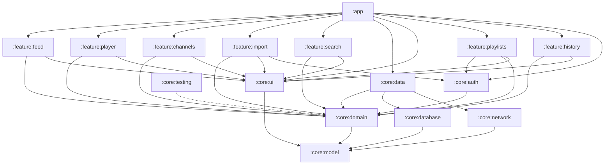

# Architecture

Clean Architecture + MVVM with unidirectional data flow (UDF). Room is the single source of truth:
the UI only reads from the database, and the network only updates it.

## Modules



| Module | Type | Responsibility |
|---|---|---|
| `:app` | Android app | `Application` (Hilt, WorkManager), `MainActivity`, `UsefulYouTubeNavHost` with the bottom navigation |
| `:core:model` | JVM | Domain models, `AppResult`, the `AppError` hierarchy |
| `:core:domain` | JVM | Use cases, repository interfaces, `ShortsDetector`, channel input parsing |
| `:core:data` | Android library | Repository implementations, mappers, CSV parser, worker, Hilt bindings |
| `:core:database` | Android library | Room: entities, DAOs, exported schema (`schemas/`) |
| `:core:network` | Android library | Retrofit (Data API), RSS parser (xmlutil), DTOs, network error mapping |
| `:core:ui` | Android library | Theme, shared components (`LoadingContent`, `MessageContent`, `VideoCard`), duration formatting, error messages |
| `:core:auth` | Android library | Google account authorization (`AuthorizationClient`): implements `AccountAuthorizer`, exposes `AccountConsent` |
| `:core:testing` | JVM | Fake repositories, `TestData`, `MainDispatcherRule`, `collectInBackground` |
| `:feature:*` | Android library | Screens: `XViewModel`, `XUiState`, `XUiEvent`, `XScreen`, `XRoute`, navigation |

Dependency rules:

- Dependencies point inwards: feature → domain ← data. Feature modules never depend on each other;
  `:app` connects screens through navigation callbacks.
- `:core:model` and `:core:domain` are JVM modules, so Android dependencies cannot leak into them.
  The domain only uses `javax.inject`/Dagger annotations (via `hilt-core`).
- Feature modules do not know about `:core:data`, `:core:database` or `:core:network`. A feature may use
  `:core:auth` only to launch the Google consent screen, which needs an Android `IntentSender`
  (`:feature:import`, `:feature:playlists`).

The package of `:feature:import` is `feature.subscriptionimport` because `import` is a Kotlin keyword.

## Layers and data flow

```
UI (Compose)  ──onEvent(UiEvent)──▶  ViewModel  ──▶  UseCase  ──▶  Repository (interface, domain)
     ▲                                  │                               │
     └──────── StateFlow<UiState> ◀─────┘                               ▼
                                                    OfflineFirst*Repository (data)
                                                      │                 │
                                               Room (Flow)       YouTubeNetworkDataSource
```

- Each ViewModel exposes one `StateFlow<UiState>` and receives events through `onEvent(UiEvent)`.
- Screens are stateless: `XScreen(state, onEvent, …navigation callbacks)`. `XRoute` connects the screen
  to the ViewModel with `hiltViewModel()` and `collectAsStateWithLifecycle()`.
- UI state combines Room flows with local ViewModel state
  (`combine(...).stateIn(WhileSubscribed(5 s))`).

## Feed refresh

`RefreshFeedUseCase` (domain) orchestrates the refresh:

1. Loads the RSS feed of every channel in parallel, at most 8 requests at a time (`Semaphore`):
   `https://www.youtube.com/feeds/videos.xml?channel_id={id}`.
2. Stores new videos with `content_kind = UNCLASSIFIED` and `details_fetched = 0`;
   existing rows are never overwritten. A video belongs to the channel whose feed was requested, not to
   the feed's `yt:channelId`, which does not always match the subscription. A channel removed while its
   feed was loading is skipped.
3. Requests `videos.list?part=contentDetails,snippet` for videos without details, in batches of 50 ids,
   and stores the ISO 8601 duration and the full description.
4. Runs videos that have details but no kind through `ShortsDetector` (also at most 8 at a time)
   and stores the result in `content_kind`.

Error handling:

- A failure of one channel does not stop the refresh. The channel is reported in
  `RefreshSummary.failedChannels` and not shown in the UI.
- If every channel failed or the details request failed, the result is `AppResult.Failure(DataError)`.

The feed shows only `REGULAR` and `LIVE_OR_PREMIERE`; `SHORT` and `UNCLASSIFIED` are hidden.
Videos the Data API does not return (deleted or private) stay hidden, and their details are requested
again on the next refresh.

Refresh triggers:

- opening the feed (`FeedViewModel.init`);
- pull-to-refresh;
- hourly in the background, only with a network connection (`FeedSyncScheduler` → `RefreshFeedWorker`).

`RefreshFeedWorker` retries on temporary errors (no network, HTTP, unknown) and gives up on an invalid
key, a rejected access token, exceeded quota, `NotFound` or a parsing error.

## Shorts detection

The `ShortsDetector` strategy (`:core:domain/shorts`):

| Class | Rule |
|---|---|
| `DurationShortsDetector` | `null` → `UNKNOWN`; `0` (`P0D`, live stream or premiere) → `NOT_SHORT`; ≤ 180 s → `SHORT`; otherwise `NOT_SHORT` |
| `UrlShortsDetector` | `HEAD https://www.youtube.com/shorts/{id}` without following redirects: `200` → `SHORT`; redirect to `/watch` → `NOT_SHORT`; any other response or error → `UNKNOWN` |
| `CompositeShortsDetector(screening, confirmation)` | The cheap screening runs first; only its `SHORT` verdict is confirmed by the expensive check. An `UNKNOWN` confirmation keeps the screening verdict |

The app uses `Composite(Duration, Url)` (see `DataModule`). Videos longer than 3 minutes need no extra
request, short regular videos are not lost, and if YouTube redirects to a cookie consent page the
duration decides.

`ClassifyVideoUseCase` maps the verdict to `VideoContentKind`: zero duration → `LIVE_OR_PREMIERE`,
`SHORT` → `SHORT`, `NOT_SHORT` → `REGULAR`, `UNKNOWN` → `UNCLASSIFIED`.

## Error model

Exceptions never reach the UI. Operations that can fail return `AppResult<T, E>`:

- `DataError`: `NoNetwork`, `InvalidApiKey`, `Unauthorized` (HTTP 401), `QuotaExceeded`, `NotFound`, `Http(code)`, `Parsing`, `Unknown`;
- `ImportError`: `UnreadableFile`, `InvalidFormat`, `NoChannels`, `Auth(AuthError)`, `Remote(DataError)`;
- `AuthError`: `ConsentRequired`, `Cancelled`, `Unavailable` (no Google Play services), `Failed`;
- `ChannelError`: `InvalidInput`, `AlreadySubscribed`, `NotFound`, `Remote(DataError)`;
- `AccountError`: `Auth(AuthError)`, `Remote(DataError)` for reading account data.

`NetworkErrorMapper` converts exceptions and HTTP responses into `DataError`. It reads the reason of
Google API errors from the response body (`errors[].reason`, `details[].reason`) and always rethrows
`CancellationException`. User-facing texts come from `AppError.message()` in `:core:ui`.

## Database

Room, schema version 4, exported to `core/database/schemas/`. Version 2 added the search tables,
version 3 the playlist tables and version 4 the watch history, all with `@AutoMigration`; `MigrationTest`
checks them against the exported schemas.

| Table | Columns |
|---|---|
| `channels` | `id` (PK), `title` |
| `videos` | `id` (PK), `channel_id` (FK → channels, `ON DELETE CASCADE`), `title`, `description`, `published_at`, `duration_seconds`, `thumbnail_url`, `content_kind`, `details_fetched` |
| `search_results` | `video_id` (PK), `position`, `channel_id`, `channel_title`, `title`, `description`, `published_at`, `duration_seconds`, `thumbnail_url`, `content_kind`; no FK, because results come from any channel |
| `search_session` | one row: `query_text`, `sort_order`, `next_page_token` (`NULL` when there are no more pages) |
| `recent_search_queries` | `query_text` (PK), `used_order` (larger is more recent; at most 10 rows) |
| `playlists` | `id` (PK, autoincrement), `title`, `remote_id` (unique; YouTube playlist id, `NULL` for app playlists), `synced_at` |
| `watch_history` | `video_id` (PK), `watched_at`, and the `VideoSnapshot` columns; at most 500 rows |
| `playlist_items` | `playlist_id` (FK → playlists, `ON DELETE CASCADE`), `video_id`, `position`, and the `VideoSnapshot` columns; PK (`playlist_id`, `video_id`) |

Indices: `videos.channel_id`, `videos.published_at`, `search_results.position`, unique
`playlists.remote_id`, `playlist_items.video_id`, `watch_history.watched_at`. `VideoSnapshot` is an `@Embedded` copy of a video for
tables that keep videos independently of the subscriptions. DAO methods that change playlists only touch
app playlists (`remote_id IS NULL`). Details and kinds are written with partial `@Update`s
(`VideoDetailsUpdate`, `VideoContentKindUpdate`). Any schema change needs a version bump and a migration.

## Search

`SearchVideosUseCase` (domain) runs a search:

1. Trims the query and saves it as a recent one.
2. `SearchRepository.fetchPage` requests `search.list` (ids only) and then `videos.list` for the found ids,
   keeping the search order and skipping videos without details.
3. `ClassifyVideoUseCase.keepWatchable` (shared with the feed refresh) classifies the videos, at most 8 at
   a time, and keeps `REGULAR` and `LIVE_OR_PREMIERE`.
4. `saveFirstPage` replaces the stored search in one transaction.

`LoadMoreSearchResultsUseCase` does the same for `search_session.next_page_token` and appends the page
after the last `position`, skipping videos that are already stored. A failure keeps the token, so the user
can retry.

`ObserveVideoUseCase` combines the feed and the search results, so the player opens found videos too;
a feed video wins when both have it. `SearchViewModel` shows the stored query and order until the user
edits them, and keeps search and "show more" errors apart.

## Playlists

`PlaylistRepository` (domain) serves app playlists and, read-only, mirrored YouTube playlists
(`PlaylistSource`). `MirroredPlaylistRepository` writes the mirror.

`SyncAccountPlaylistsUseCase` runs `AccountPlaylistsReader.read` (all playlists, their video ids and one
`videos.list` for all videos) through `AccountAuthorizer.withAccessToken`, which replaces a token rejected
with HTTP 401 once (also used by the subscription import). It classifies only videos whose kind the mirror
does not know yet, keeps watchable ones and replaces the mirror in one transaction
(`MirroredPlaylistDao.replaceAll`): playlists keep their local ids, missing ones are deleted with their
videos. `PlaylistsViewModel` syncs once on creation and on pull-to-refresh; `AuthError.ConsentRequired`
means "not connected", and **Connect** uses `AccountConsent` like the import screen. `ObserveVideoUseCase` also looks into `playlist_items`, so the player opens saved videos
of any channel.

`PlayerDestination(videoId, playlistId?)` plays a playlist. `PlayerViewModel` keeps the current video in
its `SavedStateHandle` and switches it inside the screen on **Previous**, **Next** and the player's
`ENDED` state, so back navigation returns to the playlist. `YouTubePlayer` loads a new video when its
`videoId` changes. `PlayerRoute` passes the current video to the save sheet (`VideoChanged`).

The player's **Save to playlist** sheet has its own `SaveToPlaylistViewModel` in `:feature:player`
(`save/`). `PlayerRoute` creates both ViewModels for the same back stack entry; this keeps the playback
state apart from the sheet state.

## Watch history

`YouTubePlayer` reports `PLAYING`; `PlayerViewModel` sends the current video to `RecordWatchUseCase` once
per video. `HistoryRepository` stores it with the injected `Clock` and `WatchHistoryDao.record` trims the
table to 500 rows in the same transaction. `ObserveVideoUseCase` also looks into the history.

## Channels and import

- `ChannelInputParser` (domain) accepts `UC…` ids (24 characters), `@handle`, and the links
  `youtube.com/channel/UC…` and `youtube.com/@handle` (with `m.`, `www.`, or no scheme).
- A channel added by id is verified through its RSS feed, which also provides the title.
  This costs no quota.
- A channel added by handle is looked up with `channels.list?forHandle=`.
- Account import (`ImportAccountSubscriptionsUseCase`): `AccountAuthorizer.getAccessToken()` →
  `AccountSubscriptionsReader.read(token)` (all pages of `subscriptions.list?mine=true`) →
  `ChannelRepository.importChannels`. On `DataError.Unauthorized` the token is cleared and the read is
  repeated once.
- `TakeoutCsvParser` reads columns by position (Takeout localizes the header), and handles a BOM,
  CRLF line endings, quoted fields and duplicates.

## DI and threading

- Hilt modules: `NetworkModule`, `DatabaseModule`, `DataModule`, `DispatchersModule`, `AuthModule`.
  Use cases are created through `@Inject constructor`.
- `@IoDispatcher` is injected into repositories and the file reader; ViewModels use `viewModelScope`.
- WorkManager is initialized on demand: `Application` implements `Configuration.Provider` with
  `HiltWorkerFactory`, and the default initializer is removed from the manifest.

## Navigation and screens

Navigation Compose with type-safe routes. Each feature module exports `XDestination` (`@Serializable`),
`NavGraphBuilder.xScreen(...)` and, when other screens open it, `NavController.navigateToX()`.

`UsefulYouTubeNavHost` wraps the graph in a `Scaffold` with a bottom `NavigationBar` for the
`TopLevelDestination`s (feed, search, playlists, history). The bar is shown only on these screens; the player, channels and
import open on top of them without it. Switching tabs saves and restores each tab's state
(`popUpTo(start) { saveState = true }`, `restoreState = true`). The host consumes the bar's insets, so the
screens' own scaffolds do not pad twice.

| Screen | State | Notes |
|---|---|---|
| Feed | sealed: `Loading`, `Empty`, `Error`, `Content` | refreshes on open, pull-to-refresh; an error over stored content is shown once in a snackbar |
| Video | sealed: `Loading`, `NotFound`, `Content(queue)` | IFrame player (`android-youtube-player`), `rel=0`, expandable description, survives rotation (`configChanges`); **Add channel** for videos of other channels; playlist queue with autoplay |
| Channels | data class | inline error under the input, removal with confirmation |
| Search | data class | query field, order chips, recent queries, results with **Show more**; reads the stored search |
| History | data class | videos grouped by day (`groupByDay` with the injected `Clock` and `ZoneId`), remove, clear with confirmation |
| Playlists | data class | app and YouTube sections, account state, sync with pull-to-refresh, consent, **New playlist** dialog |
| Playlist | sealed: `Loading`, `NotFound`, `Content(dialog)` | videos; rename, delete and remove videos only for app playlists |
| Import | sealed: `Idle`, `Importing`, `ConsentRequired`, `Imported`, `Failed` | file picked with `OpenDocument`; account import, see below |

### Google account authorization

`GoogleAccountAuthorization` (`:core:auth`) wraps `Identity.getAuthorizationClient`. No backend, refresh
token or client id is involved: Google Play services cache and renew the access token, and a repeated
`authorize()` returns it silently once the user has granted access.

1. `ImportViewModel` runs `ImportAccountSubscriptionsUseCase`. Without a grant it fails with
   `ImportError.Auth(AuthError.ConsentRequired)`.
2. The ViewModel asks `AccountConsent.consentScreen()` for the `IntentSender` and emits
   `ImportUiState.ConsentRequired`.
3. `ImportScreen` launches it with `StartIntentSenderForResult` and sends `ConsentLaunched`, then
   `ConsentFinished(granted)` with the result.
4. If granted, the import runs once more; a consent that is still required is reported, not shown again.

## Testing

| What | How |
|---|---|
| Use cases, `ShortsDetector`, input parser | JUnit + AssertK + fakes from `:core:testing` |
| ViewModels | `MainDispatcherRule`, Turbine or `collectInBackground` + `advanceUntilIdle`; Robolectric when the state holds an Android type (`ImportViewModel`) |
| Google authorization | Status code mapping only; `AuthorizationClient` itself needs a device with Google Play |
| DAOs, repositories | In-memory Room on Robolectric |
| Migrations | `MigrationTestHelper` on Robolectric with the exported schemas as test assets |
| Network | MockWebServer with XML/JSON fixtures in `core/network/src/test/resources` |
| CSV, mappers | Plain unit tests |
| Compose | Robolectric + `createComposeRule` (v2): feed and search states |
| WorkManager | `TestListenableWorkerBuilder`, `WorkManagerTestInitHelper` |

Kover enforces at least 80% line coverage for `:core:domain` and `:core:data` as part of `check`.
